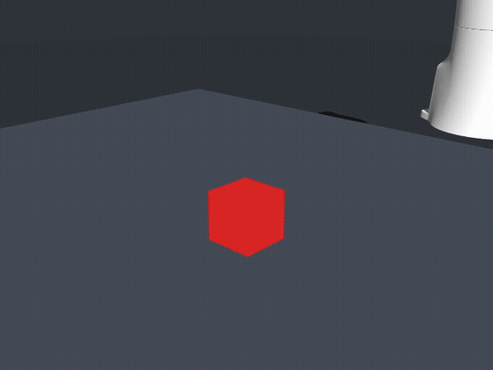

# Genesis-Kinetics

### *Asynchronous Action-Chunk Runtime & Timestamped Flight Recorder for Genesis World*

[]()
[](https://www.python.org/downloads/)
[](https://genesis-world.org/)
[](https://github.com/Genesis-Embodied-AI/quadrants)
[](https://pytorch.org/)
[]()
[]()

**Genesis-Kinetics** is an experimental runtime for studying how injected policy-computation delays affect action execution in Genesis World simulation. It combines a synthetic action-chunk worker, asynchronous execution, trajectory alignment, fallback behaviour, and timestamped telemetry. The current experiments use a scripted manipulation task on Apple Silicon; they do not demonstrate learned-VLA task performance.

<p align="center">
  
  <br>
  <em>Closed-loop Franka Emika Panda tabletop cube-pick rollout executed at 100 Hz in Genesis World 1.4.7 (Apple Metal backend).</em>
</p>

---

## 1. Why This Runtime Exists

### Latency Disturbances in Action-Chunk Execution
Modern hierarchical embodied control architectures pair high-level perception policies planning intent at 5–10 Hz with low-level motor controllers executing trajectories at 100–500 Hz. Recent open-source frameworks (such as LeRobot with Real-Time Chunking [RTC], OpenVLA, and $\pi_0$) have demonstrated the value of asynchronous execution and chunk buffering.

However, robotics researchers studying action-chunk policies under variable system latency face three key empirical challenges:

1. **Action Starvation Under Compute Stalls**: When an inference pass suffers an unexpected tail latency delay (due to network transfer, thermal throttling, or host scheduler contention), action chunk buffers deplete, causing robots to freeze or drop grasped payloads.
2. **Discontinuity Across Chunk Boundaries**: Stitching discrete chunk arrivals into continuous motor commands requires smooth ensembling and deterministic inertial fallback when deadlines are missed.
3. **The Causal Diagnostic Blindspot**: When a manipulation policy fails in simulation (e.g., dropping a cube), post-hoc analysis rarely reveals whether the failure stemmed from a flawed model prediction, joint velocity saturation, or a missed control deadline caused by host OS scheduler jitter.

Genesis-Kinetics provides an empirical fault-injection testbed and timestamped flight recorder to systematically benchmark and diagnose these failure modes inside Genesis World simulation.

---

## 2. Implementation Status & Scope Disclosures

To ensure strict engineering transparency, the table below outlines what is currently implemented, simulated, and tested in this reference repository:

| Component | Implementation Status | Technical Disclosures & Scope |
| :--- | :--- | :--- |
| **Policy Worker (`system2_worker.py`)** | Synthetic / Parameterized Policy | Generates 50-step action chunks at 5–10 Hz with configurable latency distributions (Gaussian nominal, log-normal jitter, and injected 150 ms stalls). Enables reproducible systems benchmarking independent of specific GPU weights. |
| **Simulation Environment (`genesis_env.py`)** | Closed-Loop Genesis Simulation | Franka Emika Panda (7 arm DOFs + 2 gripper DOFs) performing tabletop manipulation in Genesis World 1.4.7 with Apple Metal acceleration (`gs.metal`). |
| **Tabletop Task (`run_tabletop_pick.py`)** | Scripted Waypoint Trajectory (IK) | 5-phase pick-and-lift task (approach $\to$ descend $\to$ grasp $\to$ 14.8 cm lift $\to$ hold) used as an integration testbed to measure tracking distortion under injected compute stalls. Does not evaluate learned neural network policies. |
| **IPC Transport (`buffer.py`)** | POSIX Shared Memory (`multiprocessing.shared_memory`) | Double-buffered SPSC ring buffer with monotonic sequence counters. Non-blocking hot path (no OS mutexes or semaphores acquired in the 100 Hz control loop). |
| **Tensor Interoperability (`benchmark_dlpack_zerocopy.py`)** | In-Process DLPack Memory Sharing | Direct pointer sharing between Genesis C++/Metal memory structures and PyTorch tensors, eliminating intermediate NumPy copies. Tested in-process; not a cross-process transport. |
| **Telemetry & Flight Recorder (`telemetry/`)** | Non-blocking UDS Binary Recorder | Microsecond `.tick` binary records streaming to disk via `/tmp/rtm.sock`, capturing timing stamps for ingest, simulated delay, queue handover, and joint torque dynamics. |
| **Hardware Backends** | Tested on Apple Silicon Metal | Verified on macOS Apple Silicon Metal (`gs.metal`); architectural support for Linux CUDA (`gs.cuda`). |

> [!TIP]
> **Upstream Compiler Integration**:
> Built on top of our upstream contribution to Genesis's compiler ([Genesis-Embodied-AI/quadrants#1141](https://github.com/Genesis-Embodied-AI/quadrants/pull/1141)), which eliminated device staging memory leaks and synchronized PyTorch streams during zero-copy DLPack ndarray transfers on unified memory architectures.

---

## 3. System Architecture & Concurrency Model

```
┌─────────────────────────────────────────────────────────────────────────────┐
│                       Synthetic Action-Chunk Worker                         │
│                      (Configurable Computation Delays)                      │
│                                                                             │
│  Scripted Trajectory Generator ──► Parameterized Latency Distribution       │
│                                    (Gaussian, Log-Normal, Injected Stalls)  │
└──────────────────────────────────────┬──────────────────────────────────────┘
                                       │
                                       ▼ Timestamped Action Chunk {t_obs, seq_id, chunk[50, 7]}
                                       │
┌──────────────────────────────────────┴──────────────────────────────────────┐
│                   Double-Buffered Shared-Memory Transport                   │
│                  (POSIX Shared Memory, Non-Blocking Hot Path)               │
└──────────────────────────────────────┬──────────────────────────────────────┘
                                       │
                                       ▼
┌─────────────────────────────────────────────────────────────────────────────┐
│                            Control-Loop Process                             │
│                   (Genesis World Simulation Step @ 100 Hz)                  │
│                                                                             │
│   Chunk Time-Alignment ──► Trajectory Blending / Fallback ──► Genesis Step   │
│   (Drop Elapsed Steps)     (Exponential Blend / Damping)    (Franka Panda)  │
│                                                                      │      │
│                            [In-Process DLPack Tensor Interop] ◄──────┘      │
└──────────────────────────────────────┬──────────────────────────────────────┘
                                       │ Non-blocking Socket (/tmp/rtm.sock)
                                       ▼
┌─────────────────────────────────────────────────────────────────────────────┐
│                            Timestamped Telemetry                            │
│                                                                             │
│     Binary .tick Recorder ──► Trace Inspector ──► Web Dashboard             │
│     Events: [INGEST, IPC_HANDOVER, MOTOR_TICK, QUEUE_DEPTH, TORQUE_NORM]    │
└─────────────────────────────────────────────────────────────────────────────┘
```

> [!NOTE]
> **IPC Concurrency Model & Experimental Limitations**:
> The prototype uses double-buffered shared-memory slots and sequence checks without acquiring OS mutexes on the control hot path. The implementation’s cross-process atomicity, publication ordering, and slot-reuse correctness have not yet been formally established. It should therefore be treated as an experimental transport rather than a verified lock-free queue.

---

## 4. Empirical Benchmarks & Quantitative Findings

### Benchmark A: Stress-Test Under Injected Latency Stalls (+150 ms)
To evaluate controller behaviour under tail-latency delays, we benchmark the asynchronous configuration against a synchronous chunk-execution baseline (where the controller halts and waits synchronously when the policy buffer empties). Both baselines operate with identical PD controller gains, gravity compensation, and Genesis physics parameters under an injected +150 ms compute stall workload:

```
================================================================================
 📊 COUNTERFACTUAL STRESS-TEST BENCHMARK RESULTS
================================================================================
Configuration                       | Mean Jerk (rad/s³) | Peak Torque (N·m) | Waiting / Fallback Occupancy (%)
--------------------------------------------------------------------------------
Sync Baseline (Nominal)             |              63.79 |             29.80 |           4.4% (Waiting)
Sync Baseline (+150ms Spikes)       |             111.85 |             33.35 |          10.0% (Waiting)
Our Async Runtime (Nominal)         |              66.90 |             52.44 |           4.0% (Fallback)
Our Async Runtime (+150ms Spikes)   |              82.38 |             55.54 |           5.2% (Fallback)
================================================================================
```

#### Analysis & Control Trade-Offs:
* **Jerk vs. Commanded Torque Trade-Off**: Under the reported injected-stall workload, the asynchronous configuration reduced measured mean jerk from 111.85 to 82.38 rad/s³ while increasing peak commanded torque norm from 33.35 to 55.54 N·m. These results describe a continuity-versus-effort trade-off in this experiment; they do not independently establish task-success improvements, actuator-limit compliance, or safe behaviour.
* **Controller Occupancy Metrics**:
  * *Synchronous Waiting Occupancy (10.0%)*: The percentage of total control cycles where the robot was completely frozen waiting for delayed inference.
  * *Asynchronous Fallback Occupancy (5.2%)*: The percentage of control cycles where the action buffer was starved and the controller operated in inertial quintic damping mode.
  Synchronous waiting occupancy and asynchronous fallback occupancy are reported separately because they represent fundamentally different controller states.

---

### Benchmark B: In-Process Zero-Copy DLPack vs. Copy-Based Tensor Handover (25,000 Cycles)
Benchmarking in-process memory pointer sharing between Genesis World physics structures and PyTorch tensors:

```
====================================================================================
 📊 MICROBENCHMARK RESULTS: TENSOR HANDOVER PERFORMANCE
====================================================================================
Pattern                          | Latency per Tick   | Bytes Copied   | Effective Throughput
------------------------------------------------------------------------------------
Copy-Based (Standard Tensor Copy)|         3.368 µs     |      33.38 MB   |      396.4 MB/s
DLPack In-Process Pointer Sharing|         2.628 µs     |       0.00 MB   |      508.0 MB/s
====================================================================================
```

* **Measured Latency Reduction**: The microbenchmark measured tensor-handover overhead of 3.368 μs for the copy-based path and 2.628 μs for the DLPack path. The measured saving was 0.740 μs per operation.
* **Scope of Measurement**: The reported copying avoided is an architectural property of direct pointer projection; it is not a direct measurement of Python allocation volume, garbage-collection pauses, or end-to-end control performance.
* **Budget Context**: At 100 Hz (10,000 μs loop deadline), in-process tensor handover consumes less than 0.03% of the control loop budget.

> [!TIP]
> **Upstream Compiler Contribution ([quadrants#1141](https://github.com/Genesis-Embodied-AI/quadrants/pull/1141))**:
> The zero-copy DLPack pointer sharing tested here relies on the upstream stream synchronization and device memory leak fix contributed directly to Genesis's Quadrants JIT compiler.

---

### Benchmark C: Genesis World 3D Tabletop Rollout
* **Simulation Setup**: Franka Emika Panda tabletop pick-and-lift task executed in Genesis World 1.4.7 natively accelerated by Apple Metal (`gs.metal`).
* **5-Phase Scripted Trajectory**: Pre-grasp approach $\to$ descend $\to$ grasp $\to$ 14.8 cm vertical lift $\to$ hold.
* **Execution**: The scripted rollout completed 250 simulation steps with a configured physics timestep of 10 ms, covering 2.5 seconds of simulated time. Wall-clock deadline behaviour should be reported separately with its measurement definition. Rendered rollout available in `tabletop_cube_pick.mp4` (1.1 MB, 720x540, 50 FPS).

---

## 5. Timestamped Flight Recorder & Diagnostic Tooling

The flight recorder helps investigate the relationship between action age, buffer starvation, controller state, and simulated task outcomes. A trace can identify candidate failure mechanisms; stronger causal attribution requires controlled comparisons.

### Telemetry Packet Schema
Every control cycle emits a structured binary `.tick` packet capturing timing and state telemetry:

| Field | Type | Description |
| :--- | :--- | :--- |
| `tick_id` | `uint64` | Monotonic control loop step counter |
| `t_obs` | `float64` | Observation capture timestamp (monotonic microseconds) |
| `t_prefill_end` | `float64` | Simulated perception completion timestamp |
| `t_publish` | `float64` | Action chunk IPC publication timestamp |
| `t_motor` | `float64` | Motor controller execution timestamp |
| `buffer_horizon` | `int32` | Number of unexecuted action steps remaining in the queue |
| `controller_state`| `enum` | Controller mode (`NOMINAL`, `BLENDING`, `DAMPED_HOLD`, `BUFFER_EMPTY`) |
| `torque_norm` | `float32` | Commanded joint torque L2 norm (N·m) |
| `jerk` | `float32` | Joint jerk estimate (rad/s³) |

### Illustrative Diagnostic Scenario (Candidate Mechanism Identification)
When a robot fails to grasp or lift an object in simulation, the flight recorder allows engineers to inspect the temporal correlation between compute stalls and physical state transitions:

```
[ILLUSTRATIVE SCENARIO: OBSERVED PAYLOAD SLIPPAGE AT t = 1.84s]
├── Step 142 (t = 1.42s): Upstream worker begins simulated inference delay.
├── Step 157 (t = 1.57s): Injected stall delays chunk arrival by +150 ms.
├── Step 168 (t = 1.68s): Buffer horizon drops to 0. Controller transitions to DAMPED_FALLBACK.
└── Step 184 (t = 1.84s): Object slip coincides with prolonged buffer starvation.
└── Candidate Failure Mechanism: Action starvation under compute delay (requires controlled ablation to verify).
```

---

## 6. Interactive Flight Inspector & Web Dashboard

### 1. Interactive Terminal Rewinder
Run the interactive scrubber to step through rollout history, inspect latency milestones, and view state transitions:
```bash
python3 experiments/counterfactual_inspector.py --auto
```

### 2. Standalone HTML Flight Dashboard
Open the interactive flight recorder dashboard in any modern web browser:
```bash
open telemetry/dashboard.html
```

Features:
* **Embedded Video & Live Scrubber Sync**: Video playback and telemetry scrubbing are tied to a single unified `requestAnimationFrame` loop.
* **Side-by-Side Synchronized Charts**: Real-time waveform unrolling for Action Buffer Horizon and Joint Torque Norm with glowing oscilloscope tracking heads.
* **Diagnostic Milestone Cards**: Instant navigation to key simulation events (e.g., approach, grasp, stall injection, recovery).

---

## 7. Repository Structure

```
Genesis_AI/
├── vla_runtime/
│   ├── types.py                     # Data contracts, ActionChunkPacket, ControllerState
│   ├── buffer.py                    # Double-buffered shared-memory transport (POSIX shm)
│   ├── trajectory.py                # Elapsed-step truncation, exponential ensembling & quintic dampener
│   ├── disaggregated_serving.py     # Architectural demonstration of chunked vision prefill + action head
│   ├── system1_controller.py        # 100 Hz simulation controller loop paced by monotonic clock
│   ├── system2_worker.py            # Synthetic perception worker with parameterized latency distributions
│   └── genesis_env.py               # Genesis World 1.4.7 + Franka Panda tabletop simulation
├── telemetry/
│   ├── rtm_probe.py                 # Non-blocking UDS client transmitting binary .tick records
│   ├── recorder.py                  # Flight recorder daemon streaming events to disk
│   ├── visualizer.py                # Latency percentiles & occupancy reporter
│   ├── generate_dashboard.py        # Generates standalone interactive dashboard.html
│   └── dashboard.html               # Interactive web flight recorder dashboard
├── experiments/
│   ├── latency_profiles.py          # Nominal, network jitter, and adversarial stall distributions
│   ├── counterfactual_benchmark.py  # Automated Sync vs. Async 4-way stress test
│   ├── counterfactual_inspector.py  # Interactive terminal timeline scrubber
│   ├── benchmark_dlpack_zerocopy.py # DLPack pointer sharing vs copy-based microbenchmark
│   ├── run_disaggregated_vla.py     # End-to-end serving pipeline demonstration
│   └── run_tabletop_pick.py         # 3D closed-loop tabletop cube-picking simulation rollout
├── tests/
│   ├── test_vla_core.py             # Unit tests for ring buffer, ensembling, damping & Genesis
│   ├── test_telemetry.py            # Socket streaming & .tick binary parsing tests
│   └── test_disaggregated_serving.py # Chunked prefill & action head unit tests
├── tabletop_cube_pick.gif           # Animated rollout demonstration for instant preview (818 KB)
├── tabletop_cube_pick.mp4           # Rendered 3D visual rollout video (1.1 MB)
├── README.md                        # Rigorous systems documentation & disclosures
└── .gitignore                       # Clean Git tracking configuration
```

---

## 8. Quickstart Guide

### Prerequisites
* Python 3.10+
* PyTorch 2.x
* Genesis World (`pip install genesis-world`)
* macOS (Metal) or Linux (CUDA)

### 1. Run Unit Tests
```bash
python3 -m pytest tests/ -v
# 7 passed in 12.5s
```

### 2. Run Stress-Test Benchmark
```bash
python3 experiments/counterfactual_benchmark.py
```

### 3. Run In-Process DLPack Microbenchmark
```bash
python3 experiments/benchmark_dlpack_zerocopy.py
```

### 4. Run Disaggregated Serving Demonstration
```bash
python3 experiments/run_disaggregated_vla.py
```

### 5. Run Live Genesis World Tabletop Cube-Picking Rollout
```bash
python3 experiments/run_tabletop_pick.py
```

### 6. Launch Interactive Flight Rewinder
```bash
python3 experiments/counterfactual_inspector.py --auto
```
